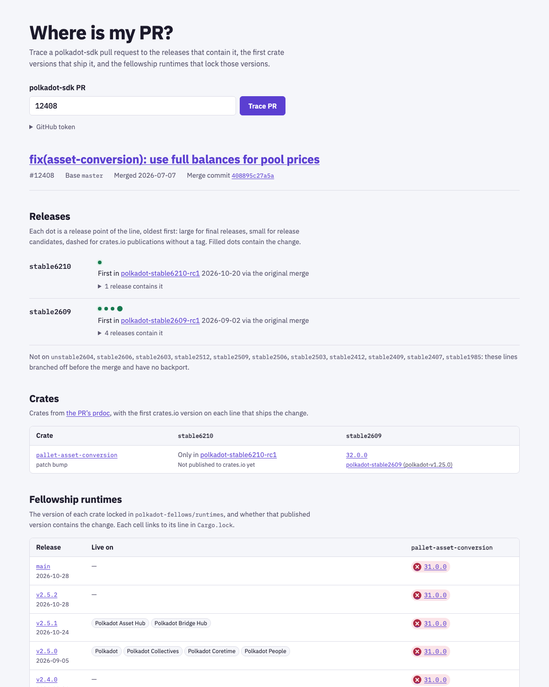

# Polkadot SDK Version Manager

This is a simple tool to manage and update the Polkadot SDK dependencies in any Cargo.toml file. It will automatically update the Polkadot SDK dependencies to their correct crates.io version.

## Installation

From [GitHub](https://github.com/paritytech/psvm):

```sh
cargo install --git https://github.com/paritytech/psvm psvm
```

From [crates.io](https://crates.io/crates/psvm):

```sh
cargo install psvm
```

## Usage

Go to the directory containing the Cargo.toml file you want to update and run `psvm`. This will automatically update the Polkadot SDK dependencies in the Cargo.toml file to their correct crates.io version.

If you want to update the local dependencies (using `path="..."`), you can use the `-o` or `-overwrite` flag, this will remove the `path` and set a crates.io version instead.

If you want to update the dependencies to a specific Polkadot SDK version, you can use the `-v` or `--version` flag, followed by the version you want to update to.

If you need to point at a specific git branch or tag (for example an unstable tag), use `--ref` with the branch/tag name that contains the release metadata. `--ref` is an alternative to `--version`; they cannot be used together.

If you want to check if the dependencies in your local Cargo.toml file are matching to a specific Polkadot SDK version, you can use the `-c` or `--check` flag along with the `--version` flag followed by the version you want to check against.

If you want to update the ORML crates in your local Cargo.toml, you can use the `-O` or `--orml` flag along with the `--version` flag to update the ORML crates along with the polkadot-sdk crates. This works only if the supplied version is present in the ORML releases.

```sh
# Go to the directory containing the Cargo.toml file you want to update
cd <cargo-toml-dir>
# Update to a specific Polkadot SDK version
psvm -v "1.3.0"
# You can also update an specific Cargo.toml file by passing its path
psvm -v "1.4.0" -p <cargo-toml-dir>/Cargo.toml
# Overwrite local dependencies (with same name as Polkadot SDK crates) with crates.io versions
psvm -v "1.7.0" -o
# Use a specific git branch or tag that already includes Plan.toml/Cargo.lock
psvm --ref polkadot-unstable2507-revive
# List all available Polkadot SDK versions
psvm -l
# Check against a particular Polkadot SDK version without updating the Cargo.toml file
psvm -v "1.4.0" -c
# Update the ORML dependencies along with the Polkadot SDK dependencies.
psvm -v "1.6.0" -O
```

> Listing all available Polkadot SDK versions requires querying the GitHub API, so your IP may be rate-limited. If a rate limit is reached, the tool will fallback to the GitHub CLI to list the versions. Ensure you have the GitHub CLI installed and authenticated to avoid any issue, or you can alternatively set the `GITHUB_TOKEN` environment variable to your GitHub API token.

## Where is my PR?

`web/` holds a static web app that traces a polkadot-sdk PR to the releases that contain it, the first crate
versions that ship it, and the [fellowship runtimes](https://github.com/polkadot-fellows/runtimes) releases that
lock those versions. It is deployed to GitHub Pages by `.github/workflows/pages.yml`.



For example, [#12408](https://github.com/paritytech/polkadot-sdk/pull/12408) (`pallet-asset-conversion`) is in
`polkadot-stable2609` (`polkadot-v1.25.0`) and its rcs and in `polkadot-stable6210-rc1`, but not in `stable2606` or
`unstable2604`. The first fixed crate version is `pallet-asset-conversion 32.0.0`. Every fellowship runtimes release
so far locks `31.0.0`, so none of them contains the change.

How it works:

- `psvm index` precomputes everything that does not depend on the PR into static JSON: polkadot-sdk release lines,
  their tags and untagged crates.io publications ("Post crates release" commits), each crate's version at every
  release point, the locked versions and spec versions of every runtimes release, and the runtime versions live on
  Polkadot, Kusama and their system chains.
- In the browser, the app reads the PR, its prdoc and its backport PRs, then finds the first release of each line
  that contains the merge (or backport) commit. It uses a binary search with GitHub's compare API, which takes about
  5–30 API calls per lookup. Runtimes are matched by published crate version, never by comparing version numbers.
- The PR page also lists the PR's open backports, and flags lines whose backport is merged but in no final release
  yet, so not on crates.io. `#/releases` shows every release line with the backports still open into it, and
  `#/release/<tag>` shows the open and unpublished backports a single release is missing. The runtimes table names
  the polkadot-sdk release each runtimes release builds on, linked to that page, with its line's open and unpublished
  backport counts.
- `#/unpublished` lists the backports merged into each line after its latest final release whose prdoc bumps a
  published crate (from the index, plus those merged since it was built). Backports without one, such as CI changes,
  need no release: polkadot-sdk's `check-semver` CI requires every crate a PR changes to be in its prdoc. `#/missed`
  lists master PRs an older stable line released but a newer one has in no release.

Run it locally:

```sh
# Build the index (needs a GitHub token for the GraphQL API; the cache makes reruns fast)
GITHUB_TOKEN=$(gh auth token) cargo run -- index --out web/public/data --cache-dir target/psvm-index-cache
# Optional: SUBSCAN_API_KEY=<key> finds Westend upgrades from Subscan instead of searching the chain over RPC
# Serve the app on http://localhost:5173/#/pr/12408
cd web && npm install && npm run dev
# Sanity-check the index output (also run before every deploy), and unit-test the parsing helpers
npm run check-index
npm test
```

## Using as a Library

You can use `psvm` as a library in your Rust project by adding it to your `Cargo.toml`:

```toml
[dependencies]
psvm = "0.2"
```

Basic usage example:

```rust
use psvm::{get_version_mapping_with_fallback, update_dependencies};
use std::path::Path;

#[tokio::main]
async fn main() -> Result<(), Box<dyn std::error::Error>> {
    // Fetch version mappings for a specific Polkadot SDK version
    let version = "1.14.0";
    let crates_versions = get_version_mapping_with_fallback(
        "https://raw.githubusercontent.com",
        version
    ).await?;
    
    // Update dependencies in a Cargo.toml file
    let cargo_toml_path = Path::new("path/to/Cargo.toml");
    update_dependencies(cargo_toml_path, &crates_versions, false, false)?;
    
    Ok(())
}
```

See the [API documentation](https://docs.rs/psvm) for more details on available functions.

## Workflow

To update a `Cargo.toml`, the tool will fetch the `Plan.toml` file (used to publish crates into crates.io) from the release branch in Polkadot SDK associated to the version input (`--version` argument), generate a mapping (crate -> version) filtering all crates that were not published in this released (i.e. `publish = false`) **but keeping the [crates published by `parity-crate_owner`](https://crates.io/users/parity-crate-owner) (even if they were not published in this release)**, and overwrite the input Cargo.toml file to match the version from the mapping (i.e [v1.6.0 `Plan.toml`](https://raw.githubusercontent.com/paritytech/polkadot-sdk/release-crates-io-v1.6.0/Plan.toml)).

In specific versions, the `Plan.toml` file may not exists (i.e. v1.3.0). In this case, the tool will fallback to the `Cargo.lock` file (i.e. [v1.3.0 `Cargo.lock`](https://raw.githubusercontent.com/paritytech/polkadot-sdk/release-crates-io-v1.3.0/Cargo.lock)) from the branch, generate a mapping using this file and overwrite the input Cargo.toml file to match the version from the mapping. The only concern to be aware in this scenario is that the `Cargo.lock` file may contain dependencies that are not published in crates.io, and the tool will not be able to filter them out cause it is not possible to determine if a crate is published or not (with this file). If you have a local dependency with a name similar to a crate not published, the tool will overwrite it, so be careful. Currently, this only happens with v1.3.0, but as the branches can change at any time, it is important to be aware of this. The tool will alert with a message "Failed to get Plan.toml, falling back to Cargo.lock." if this happens.
